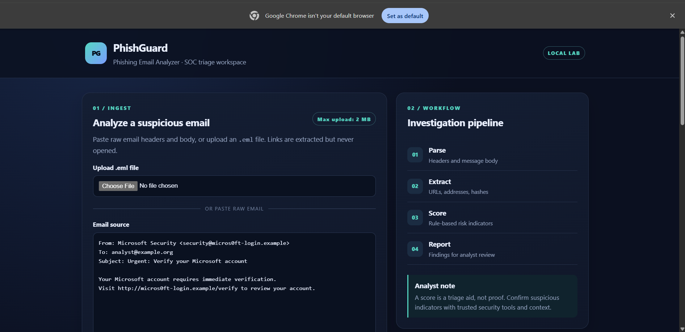
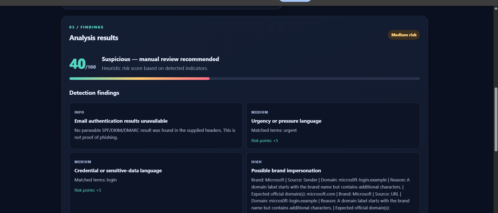

<div align="center">

# 🛡️ PhishGuard

### 🔍 Phishing Email Analysis & Threat Detection

**Analyze suspicious emails. Detect phishing indicators. Investigate potential brand impersonation.**

A Python-powered cybersecurity tool for email threat analysis, rule-based risk scoring, and suspicious indicator investigation.

<br>

[](https://www.python.org/)
[](https://flask.palletsprojects.com/)
[](https://developer.mozilla.org/en-US/docs/Web/HTML)
[](https://developer.mozilla.org/en-US/docs/Web/CSS)

<br>

[📸 Screenshots](#-screenshots) •
[✨ Features](#-key-features) •
[🧪 Demo](#-analysis-workflow) •
[🔐 Security](#-security--limitations)

<br>

**[View Repository](https://github.com/rutikashinde273/PhishGuard-Email-Analyzer)**

</div>

---

## 📑 Table of Contents

- [🎯 About the Project](#-about-the-project)
- [📸 Screenshots](#-screenshots)
- [✨ Key Features](#-key-features)
- [🧠 Detection Capabilities](#-detection-capabilities)
- [⚙️ Technology Stack](#️-technology-stack)
- [🔄 Analysis Workflow](#-analysis-workflow)
- [📂 Project Structure](#-project-structure)
- [🔐 Security & Limitations](#-security--limitations)
- [👩‍💻 Author](#-author)

---

## 🎯 About the Project

**PhishGuard** is a Python-based email security analysis application designed to help investigate potentially malicious emails.

Phishing attacks often use deceptive sender addresses, suspicious URLs, urgent language, and brand impersonation to trick recipients into revealing sensitive information.

PhishGuard examines these indicators and presents its findings through a browser-based dashboard, helping users understand why an email may require further investigation.

### 💡 Project Goals

- 🔎 Identify suspicious characteristics in email messages.
- 🌐 Extract URLs and email addresses for investigation.
- 🎭 Detect potential brand impersonation attempts.
- 📊 Calculate a rule-based risk score.
- 🧾 Present findings in a readable, structured format.
- 🔐 Generate a SHA-256 hash to identify the analyzed evidence.

> **Core idea:** Turn raw email data into understandable security findings that can support an initial phishing investigation.

---

## 📸 Screenshots

<div align="center">

### 🖥️ PhishGuard Dashboard

<a href="docs/screenshots/dashboard.png">
  
</a>

*The PhishGuard web interface for submitting and analyzing suspicious emails.*

<br>

### 🚨 Phishing Analysis Results

<a href="docs/screenshots/analysis-result.png">
  
</a>

*Example analysis showing the risk score, verdict, and detected indicators.*

</div>

---

## ✨ Key Features

<table>
<tr>
<td width="50%">

### 📧 Email Analysis

Analyze pasted email content or upload supported `.eml` files for inspection.

</td>
<td width="50%">

### 🔍 Header Inspection

Examine available sender, recipient, and Reply-To information.

</td>
</tr>
<tr>
<td width="50%">

### 🌐 URL Extraction

Extract URLs from email content for security investigation.

</td>
<td width="50%">

### 🎭 Brand Impersonation

Identify suspicious sender addresses and URL domains that may imitate supported brands.

</td>
</tr>
<tr>
<td width="50%">

### 📊 Risk Scoring

Combine detected indicators into a rule-based risk score and verdict.

</td>
<td width="50%">

### 🧾 Evidence Hashing

Generate a SHA-256 hash of the supplied email evidence.

</td>
</tr>
<tr>
<td width="50%">

### 📋 JSON Reporting

Export analysis results in JSON format for documentation and further review.

</td>
<td width="50%">

### 🖥️ Web Dashboard

Review the analysis through a browser-based interface built with Flask, HTML, and CSS.

</td>
</tr>
</table>

---

## 🧠 Detection Capabilities

PhishGuard uses rule-based checks to identify indicators that may warrant further investigation.

| Detection Area | What It Examines |
|---|---|
| 📩 Sender Analysis | Sender information and potentially suspicious domain relationships |
| ↩️ Reply-To Analysis | Differences between sender and Reply-To domains |
| 🌐 URL Analysis | Extracted URLs and suspicious URL patterns |
| 🔗 Link Mismatch | Differences between displayed links and their destinations, where detectable |
| 🎭 Brand Impersonation | Potential lookalike domains involving supported brands |
| ⚠️ Urgency Indicators | Language that pressures recipients to act quickly |
| 🔑 Credential-Related Language | References to login, account verification, or credentials |
| 🛡️ Authentication Results | Supplied SPF, DKIM, and DMARC results when available |
| #️⃣ Evidence Integrity | SHA-256 hash of the supplied email evidence |

**Important:** These checks identify indicators, not definitive proof of malicious activity. Detection depends on the implemented rules and the available email data.

---

## 🧰 Technology Stack

<div align="center">

| Technology | Purpose |
|:---:|---|
|  | Analysis logic and backend |
|  | Web application framework |
|  | Dashboard structure |
|  | Dashboard styling |
|  | Version control |
|  | Source code hosting |

</div>

---

## 🔄 Analysis Workflow

```text
       ┌─────────────────────────┐
       │     📧 Email Input      │
       │  Paste or upload .eml   │
       └────────────┬────────────┘
                    ▼
       ┌─────────────────────────┐
       │    ⚙️ Email Parsing     │
       │ Headers and body text   │
       └────────────┬────────────┘
                    ▼
       ┌─────────────────────────┐
       │ 🔍 Indicator Extraction │
       │ URLs, addresses, text   │
       └────────────┬────────────┘
                    ▼
       ┌─────────────────────────┐
       │    🛡️ Rule Analysis     │
       │ Suspicious patterns     │
       └────────────┬────────────┘
                    ▼
       ┌─────────────────────────┐
       │     📊 Risk Scoring     │
       │ Score and findings      │
       └────────────┬────────────┘
                    ▼
       ┌─────────────────────────┐
       │   🧾 Results & Report   │
       │ Dashboard / JSON export │
       └─────────────────────────┘
```

---

## 🧪 Analysis Workflow

For a controlled demonstration, use a fictional test email such as:

```text
From: Microsoft Security <security@micros0ft-login.example>
To: analyst@example.org
Subject: Urgent: Verify your Microsoft account

Your Microsoft account requires immediate verification.
Visit http://micros0ft-login.example/verify to review your account.
```

### Indicators to Investigate

- 🎭 A sender domain resembling a supported brand
- 🌐 A URL using the same suspicious domain
- ⚠️ Urgent language
- 🔑 Account verification language
- 🛡️ Email authentication results that are missing or inconclusive

The expected outcome is a suspicious-email finding that warrants manual review. The precise score and verdict depend on the application's current rules.

> The `.example` domain is reserved for examples and is used here to avoid directing users to a real suspicious website.

---

## 📂 Project Structure

```text
PhishGuard-Email-Analyzer/
│
├── app.py                  # Flask application
├── analyzer.py             # Email analysis and risk scoring
├── requirements.txt        # Python dependencies
├── .gitignore              # Excluded files
│
├── templates/
│   └── index.html          # Web dashboard
│
├── static/
│   └── style.css           # Dashboard styling
│
├── docs/
│   └── screenshots/
│       ├── dashboard.png
│       └── analysis-result.png
│
└── README.md
```

---

## 🔐 Security & Limitations

- PhishGuard is an educational tool for initial phishing triage, not a replacement for a dedicated email security platform.
- Rule-based scoring may produce false positives and false negatives.
- Brand impersonation detection covers selected brands and patterns; it cannot identify every impersonation attempt.
- SPF, DKIM, and DMARC results are parsed when supplied. The application does not independently authenticate the sending server simply by reading these values.
- A SHA-256 hash identifies the supplied evidence but does not prove that an email is authentic or malicious.
- Extracted URLs should be investigated cautiously; the tool's analysis should not require opening suspicious links.
- Use fictional samples for public demonstrations and avoid publishing private email content or sensitive information.

---

## 👩‍💻 Author

<div align="center">

### Rutika Shinde

Cybersecurity | Python | Email Threat Analysis

[](https://github.com/rutikashinde273)

[](https://github.com/rutikashinde273/PhishGuard-Email-Analyzer)

</div>

---

<div align="center">

### 🛡️ Investigate suspicious emails. Understand the indicators. Make informed decisions.

**Built for cybersecurity learning and authorized analysis.**

</div>
